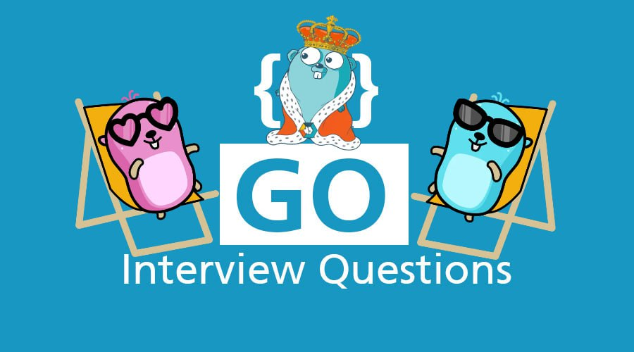

# Golang Interview Questions and Answers

A comprehensive collection of best practices, design patterns, and learning resources for software developers with a special focus on the Go programming language.

## 📋 Table of Contents

## 🎯 About

This repository contains a curated collection of documentation, guides, and best practices for software development. It's designed to help developers improve their programming skills, master software architecture, and prepare for technical interviews. The content is particularly valuable for Go developers and those preparing for technical interviews.

## 🤝 Contributing

Contributions are welcome! If you'd like to improve the documentation or add new content:

1. Fork the repository
2. Create a feature branch (`git checkout -b feature/amazing-content`)
3. Commit your changes (`git commit -m 'Add amazing content'`)
4. Push to the branch (`git push origin feature/amazing-content`)
5. Open a Pull Request
